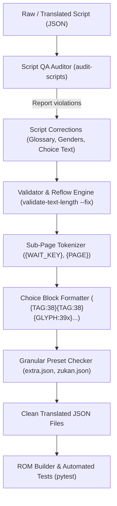

# Text Validation Engine Overhaul, Choice Formatting & Localization QA Design

## 1. Overview and Problem Statement

Playtesting the current Chrono Trigger DS Russian localization build revealed several visual, formatting, and translation anomalies across dialogues, tutorials, and menus:

1. **Choice Dialog Alignment & Cursor Misplacement**:
   - In dialogue choice boxes (e.g. Truce Inn: `cmes0.json` #75, #78, and Pianist #46), choice options (`{GLYPH:394}`–`{GLYPH:403}`) were placed horizontally on the same line as the preceding question or sentence instead of starting on dedicated lines below it.
   - The finger cursor on the top screen rendered on lines 2 and 3 pointing into empty space.
   - When a choice option wrapped across multiple lines (`Сыграй\nчто-нибудь грустное!`), the Nintendo DS engine's bottom-screen touch button generator stripped the newline `\n` without inserting a space, producing glued text (`Сыграйчто-нибудь грустное!`).
2. **Sub-Page Anchor Miscalculation (`{WAIT_KEY}`) & Premature Line Breaks**:
   - The text reflow engine (`src/text/reflow.py`) treated `{WAIT_KEY}` as plain inline text rather than an independent sub-page boundary.
   - In the Mayor's Manor weapon tutorial (`cmes0.json` #92), the text block between two `{WAIT_KEY}` tags expanded to 5 lines (violating the 3-line dialogue limit). The line `Однако это не` broke prematurely after only 13 characters because the reflow engine calculated width continuously from the text before `{WAIT_KEY}`.
   - In combat status tutorials (`cmes0.json` #106, #110), original newlines between status titles and descriptions were collapsed into spaces, creating glued sentences like `Медленно Увеличивает...` and `Блокировка Запрещает...`.
3. **Translation Inaccuracies, Machine Translation Artifacts & Grammatical Gender Mismatch**:
   - A male NPC in Truce Inn (`cmes0.json` #77) spoke with female past-tense verb agreement: *«я никогда не видела такого фестиваля!»* (due to untagged English *«I've never seen»*).
   - In `cmes0.json` #92, *«You must be proficient with a weapon to use it, and everyone's proficiencies are different»* was mistranslated as *«уровень владения у всех разный»*, falsely implying a weapon-leveling mechanic absent from Chrono Trigger.
   - In `cmes0.json` #110, *«Prevents the use of techs»* was translated as *«Запрещает использование техников»* (translating *techs* as technicians/engineers rather than techniques).
   - In `cmes0.json` #106, status *Slow* was rendered as adverb *«Медленно»* rather than noun *«Замедление»*.
4. **Interface Truncation & Button Bounding Violations**:
   - In the Extras menu (`extra.json`), *«Музыкальная шкатулка»* (~130px) exceeded the ~95px button frame.
   - In the Bestiary screen (`zukan.json`), stat labels were truncated to 6–7 characters by the hardware display buffer (*«Слабост»*, *«Поглоща»*, *«Имуните»*) because the column width is only ~48px while the preset permitted up to 80px.

---

## 2. Architectural Components & Changes

### 2.1. Token-Aware Reflow Engine (`src/text/reflow.py`)

The reflow engine is restructured around a segment-based tokenizer:

1. **Sub-Page Decomposition**:
   - Before applying word wrapping or line budgeting, dialogue text is split into independent sub-pages using the delimiter pattern:
     ```python
     SUBPAGE_DELIMITER_PATTERN = re.compile(r"(\{WAIT_KEY\}|\{PAGE\}|\{GLYPH:407\}|\{GLYPH:408\})")
     ```
   - Each sub-page is processed independently:
     - Accumulated line pixel width is reset to `0px`.
     - Current line count is reset to `0`.
     - The first line of each sub-page starts on a fresh line.
   - Line counts for each sub-page are strictly validated against `max_lines` (default 3 for `dialogue`). Sub-pages exceeding `max_lines` raise validation warnings or are split with `{PAGE}` if `--auto-paginate` is active.

2. **Choice Tag Formatting & Invariant Protection**:
   - Choice tags (`{GLYPH:394}` through `{GLYPH:403}`) are treated as atomic line-bound blocks:
     - Every choice option MUST start on a new line with standard indentation:
       ```text
       \n{TAG:38}{TAG:38}{GLYPH:39x}Option Text{GLYPH:39y}
       ```
     - A choice option MUST NEVER contain internal newline breaks (`\n` or `{LINE}`). Any internal line break is collapsed to a single space.
     - Choice option text pixel width is validated against `CHOICE_MAX_WIDTH_PX = 110`.
     - The total line count of prompt text plus choice lines must not exceed `max_lines`.

3. **Title-Description Indentation Preservation**:
   - Entries following the pattern `Title\n   Description` (e.g. status effect explanations in tutorials) retain their structural newline and leading 3-space indentation. Reflow is applied strictly to the description portion.

### 2.2. Granular UI Presets (`src/text/presets.py`)

New explicit entry-level constraints are added to `get_constraints_for_entry()`:

1. **Extras Menu (`extra.json`)**:
   - `id: 0..15` (Menu category buttons): `max_width_px = 95`, `max_lines = 1`, `reflow = False`.
     - *«Music Box»* $\rightarrow$ **«Фонограф»** (fits comfortably within 95px).
     - *«Item Encyclopedia»* $\rightarrow$ **«Энциклопедия»** or **«Каталог предметов»**.
   - `id: 16..31` (Bottom description bar): `max_width_px = 224`, `max_lines = 2`, `reflow = True`.

2. **Bestiary Details (`zukan.json`)**:
   - `id: 10..13` (Stat labels): `max_width_px = 48`, `max_lines = 1`, `reflow = False`.
     - `Weak` $\rightarrow$ **«Слаб.»** (~34px)
     - `Absorbs` $\rightarrow$ **«Поглощ.»** (~45px)
     - `Immune` $\rightarrow$ **«Иммун.»** (~42px)
   - `id: 16` (Discovered label): `max_width_px = 65`, `max_lines = 1` $\rightarrow$ **«Найдено:»**.

3. **Status Effect Tutorials (`cmes0.json`)**:
   - `id: 98..114`: Line 1 title (max 90px), lines 2–3 description (max 210px with 3-space indent).

### 2.3. Project Glossary Expansion (`glossary/ctds_terms.json`)

Standardized terms and rules are registered:

- **Currency**: `З` (short for золото, e.g. `10 З`, `200 З`).
- **Stats**: `ОЗ` (Очки Здоровья / HP) and `ОМ` (Очки Магии / MP).
- **Combat Mechanics**:
  - `Tech` / `Techs` $\rightarrow$ `Техника` / `Техники` (genitive plural: `техник`, strictly forbid `техников`).
  - `Proficiencies` $\rightarrow$ `Специализация по оружию` / `Типы оружия` (strictly forbid `уровень владения`).
- **Status Effects**:
  - `Lock` $\rightarrow$ `Блок техник` (noun phrase, prohibits tech usage).
  - `Slow` $\rightarrow$ `Замедление` (noun, not adverb `Медленно`).
  - `Stop` $\rightarrow$ `Стоп` / `Остановка`.
  - `Chaos` $\rightarrow$ `Смятение`.
  - `Sleep` $\rightarrow$ `Сон`.
  - `Poison` $\rightarrow$ `Яд`.
- **Locations & Character Genders**:
  - `Truce` $\rightarrow$ `Трус` (use `мэр города Трус` to avoid awkward ambiguity).
  - Truce Inn male patron (`cmes0.json` #77) gender set to masculine: *«я никогда не видел такого фестиваля!»*.

### 2.4. Static Script QA Auditor (`scripts/audit_script_translations.py`)

A comprehensive CLI audit tool (`python src/cli.py audit-scripts` or standalone script) scans all JSON script files in `translated text/` and `ai translated text/` to verify:

1. **Choice Invariants**: Checks that every choice glyph has a leading newline, no internal newlines, and does not exceed 110px.
2. **Sub-Page Limits**: Flags any segment between `{WAIT_KEY}` or `{PAGE}` that exceeds 3 lines.
3. **Glossary & Banned Terminology**: Scans for known machine translation errors (`техников`, `уровень владения`, `Медленно Увеличивает`).
4. **Gender Consistency**: Flags past-tense feminine verb endings (`-ла`, `-лась`) in lines attributed to male NPCs.

---

## 3. Data Flow & Execution Sequence



---

## 4. Verification and Testing Strategy

1. **Unit Testing (`tests/test_text_validator.py`)**:
   - Test sub-page splitting on `{WAIT_KEY}` and `{PAGE}` ensuring line counts and widths reset cleanly.
   - Test choice formatting ensuring leading `\n` is maintained and internal `\n` is collapsed.
   - Test granular presets for `extra.json` and `zukan.json` verifying correct width enforcement.
2. **Automated Test Suite**:
   - Run `pytest` to confirm 100% pass rate across the full project test suite.
   - Run `ruff check .` to ensure linting compliance.
3. **ROM Build & Screenshot Verification**:
   - Re-run `python src/cli.py validate-text-length --fix` across all translation files.
   - Rebuild test ROM and verify that the 10 problematic screens now render with flawless alignment, correct cursor positions, clean button labels, and accurate terminology.
